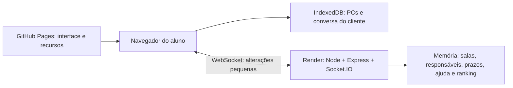

# TechManager

Central de suporte colaborativa para aulas de informática. O professor cria a sala; os alunos assumem chamados e resolvem problemas em computadores simulados independentes.

**[Abrir o TechManager](https://fernandobalbino.github.io/TechManager/)** · [Código no GitHub](https://github.com/FernandoBalbino/TechManager)

## Usar na aula

1. Abra o site, selecione **Sou professor**, informe seu nome e crie a sala.
2. Compartilhe o código do lobby. Os alunos entram com nome e código, sem conta externa.
3. Em cada Chromebook, use **Preparar** para colocar os recursos do Windows em cache antes da partida. O pacote local tem aproximadamente 25 MB, entregue pelo GitHub Pages.
4. Ajuste duração e prazos nas opções do professor e inicie o expediente. O padrão é 45 minutos.
5. Exporte a sessão ao final e antes de qualquer atualização do servidor. O ranking e os chamados são temporários.

**Primeiro acesso ao Render Free:** o servidor pode levar cerca de um minuto para acordar. Aguarde o botão de entrada ficar disponível. Não é necessário manter monitores externos fazendo requisições.

## Regras

- Início: um chamado por aluno online. Depois: **um chamado compartilhado a cada 60 segundos**.
- 50 tipos de cenário, sorteados sem repetição por ciclo. Cada reaparecimento cria um atendimento independente.
- Até dois chamados próprios e uma ajuda. Apenas um Windows fica ativo; a troca salva o PC e a conversa em IndexedDB.
- Prazos desde a entrada na fila: fácil 5, médio 8, difícil 12 minutos. O professor pode mudar antes de iniciar.
- Pausa congela chegada, prazos e relógio dos simuladores. Chamados vencidos aparecem no Histórico e liberam as vagas.
- Pontos individuais: 1/2/3. Em dupla: 2/4/6 **para cada pessoa**, se o ajudante aceitou, enviou mensagem e continua vinculado ao concluir.
- Conclusão exige corrigir os objetivos, pedir confirmação ao cliente e escrever um resumo de pelo menos 10 caracteres.
- Ranking por pontos, com empates na mesma colocação e contadores separados de atendimentos solo, em dupla e ajudas.

## Arquitetura



O Windows, os arquivos virtuais, os downloads de instaladores, as contas fictícias e o bot do cliente são locais. Nenhuma chamada de IA ou transmissão de tela é usada. Os tamanhos exibidos nos instaladores são virtuais.

O servidor decide posse, capacidade, prazo, pontos e conclusão duplicada. A correção técnica é conferida no cliente. É uma atividade didática, sem garantia antifraude. As conversas de ajuda ficam disponíveis aos dois participantes e ao professor.

### Retomar depois de reiniciar o servidor

O professor usa **Sou professor → Restaurar uma sessão anterior**, selecionando a exportação ou o último backup deste navegador. A sala restaurada recebe um novo código e volta pausada. Os alunos entram com os mesmos nomes, no mesmo navegador e perfil usados antes; o sistema busca seus PCs salvos e preserva os vínculos.

O backup automático é montado localmente a cada 10 segundos, sem pedir cópias periódicas ao backend. Ele depende desta aba permanecer aberta e do espaço do navegador. A exportação manual é a cópia transportável da sala. Os PCs dos alunos não fazem parte do arquivo do professor.

Não limpe os dados do site durante a aula. A reconexão de uma sala que ainda existe usa um token local, sem novo cadastro. Outro navegador ou perfil não possui o PC anterior.

## Desenvolvimento local

Node.js 22 ou 24:

```sh
npm ci
npm run dev
```

Vite em `http://localhost:5173` e servidor em `http://localhost:3001`. A interface usa o proxy do Vite. Para testar em dois navegadores, use nomes diferentes. `qa.html` é uma bancada local com relógio controlado e os 50 cenários; ela não é incluída na publicação.

```sh
npm test
npm run build
```

Os testes criam professor e 15 conexões **exclusivamente em loopback**; não aceitam URL do Render. Validam disputas, limites, ajuda, privacidade, pausas, prazos, ciclos, exportação e restauração. Os 50 cenários são verificados com o código real do sistema de arquivos, rede, programas e serviços do OSLab, com relógio controlado.

## Publicação

- **Frontend:** GitHub Pages, workflow `.github/workflows/pages.yml`, branch `main`. Build em `dist/client`, base `/TechManager/`.
- **Variável do repositório:** `VITE_REALTIME_URL`, com a URL HTTPS do serviço exclusivo no Render.
- **Backend:** criação direta no Render, configuração documentada em `deployment/render-service.json`. Plano `free`, uma instância, região Virgínia, apenas Express e Socket.IO em produção.
- **Origem permitida:** `https://fernandobalbino.github.io`, sem caminho. O backend não serve os arquivos estáticos do simulador.
- **Porta:** `process.env.PORT`, bind em `0.0.0.0`; endpoint `/health`.
- Não vincule uma segunda instância sem implementar armazenamento compartilhado. Não adicione reinícios/deploys durante uma aula: o estado do servidor é temporário.

Os arquivos `.openai/`, `worker/` e a preparação de build do template Product Design foram preservados. A publicação deste projeto usa GitHub Pages e Render.

## Banda e limites da verificação

O teste com 15 alunos e o professor é local. Os testes públicos devem se limitar a uma checagem breve com professor e dois alunos, até **50 MB adicionais**, com **2 GB como teto absoluto**, nunca como meta. Verifique as métricas antes e depois. Sem medição confiável, mantenha a validação de carga local.

Os assets do Windows e fontes vêm do Pages; só os eventos da sala e o chat de ajuda saem do Render. Não há atualização de relógio a cada segundo pelo servidor. Os testes não confirmam a franquia mensal da conta nem abrangem outros serviços. Resultados observados e publicação estão em `deployment/verification.md`.

## Origem e créditos

Projeto independente de Fernando Balbino, com cópias adaptadas:

- [OSLab](https://github.com/FernandoBalbino/OSLab), commit `fe37d700205d05e94254060a3dba986c87bb6341`, em `public/windows/`.
- [HelpDeskSimulator](https://github.com/FernandoBalbino/HelpDeskSimulator), commit `b168132f7f90de8422ea757ce3c2f64539d6e060`. Os 15 diálogos e validadores originais estão em `shared/legacy/`.
- Avisos e licenças do Windows preservados em [THIRD_PARTY_NOTICES](public/windows/THIRD_PARTY_NOTICES.md) e nos diretórios de assets. Créditos originais também em `HELPDESK_CREDITS.md` e `OSLAB_CREDITS.md`.
- Fotografias locais do Unsplash: créditos individuais em `HELPDESK_CREDITS.md`. Ilustram personagens fictícios e avatares de demonstração.
- Interface: fonte Inter (SIL OFL) e Phosphor Icons (MIT). A referência visual aprovada está em `design/approved.png`.

As marcas identificam interfaces simuladas. Nenhum serviço real recebe os e-mails ou senhas fictícias usados nos atendimentos. Os repositórios originais e os serviços de aulas existentes permanecem independentes.
